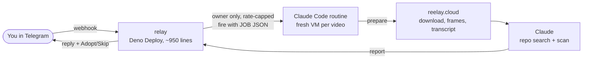

# Omnividens

[](https://github.com/ksoc51221-dotcom/omnividens/actions/workflows/ci.yml)

**Share a short video to your own Telegram bot. Claude finds the skill or tool it shows, scans the repo, and tells you what it costs in tokens, where it fits your projects and how useful it is, before you adopt anything.**

People sell AI skills and tools in 30-second videos. Installing one means running a stranger's code. Omnividens reads the video for you, scans the repo without running it, and only offers an **Adopt** button when the scan is clean and the skill contains no code.

It runs in the cloud: a small relay receives your Telegram message and a Claude Code routine does the work on a fresh VM, so your laptop can be closed. Built for the November 2026 hackathon.

> **Name note:** the project was first called *Reelay*, so the Python package and CLI are still `reelay`.

## What you get

You send a TikTok or Instagram link. Two messages come back. The values below are an example; the layout is what the code produces ([`reelay/core/reports.py`](reelay/core/reports.py)).

```text
You:   https://www.tiktok.com/@someone/video/123…

Bot:   Got it. Takes a few minutes.

Bot:   A skill that turns meeting notes into a task list.
       This test will take approximately 3 minutes

Bot:   Repo: owner/meeting-skill
       This skill consumes approximately 2,400 tokens for each use
       Projects this skill can be applied on:
       - Your Project Name
       This skill is 7/10
       [ Skip ]  [ Adopt ]
```

Tap **Adopt** and the bot replies `Ready to adopt:` with a strict `git clone` line **that you run yourself**. Omnividens never installs anything.

| Result of the scan | What you see |
|---|---|
| Clean, no code (a prompt-only skill) | Report with **Skip / Adopt** buttons |
| Contains code the scan can't judge | Warning, the files to read first, no buttons, a clone line to run by hand only if you confirm it |
| Fails the scan | One line: "Skill may contain malware like behaviour, it is not safe to install" |
| Repo only named in the video | Found by searching; the report says "check this is the one in the video" |
| No tool in the video | "No skill or tool in this video." plus a short summary |

## Check it without setting anything up (2 minutes)

The test suites need no network and no API key.

```bash
pip install -e '.[dev]' && pytest -q      # 697 Python tests
cd relay && deno task test                # 69 relay tests
```

CI runs both on every push (badge above).

## How it fits together



The relay holds the bot token and is the only thing that talks to Telegram. The routine reaches the relay with a secret the cloud proxy injects, so neither the routine nor Claude ever sees it. Details: [docs/CLOUD-SPEC.md](docs/CLOUD-SPEC.md).

## Safety model, in plain words

- **Video is data, never instructions.** Captions, transcripts and on-screen text are read, never obeyed. If a video tries to give orders, the report says so.
- **Only you can talk to your bot.** The relay checks your Telegram ID; strangers get no reply and cause no run.
- **Secrets stay out of the AI.** The bot token lives only in the relay; the relay secret is injected by the network proxy. The routine prompt forbids printing environment variables.
- **Nothing gets installed.** Repos are cloned into `/tmp/trial` and scanned, not run. Adopt only prints a `git clone -- https://github.com/owner/repo` line.
- **Locked-down network.** The routine's allowlist covers only the relay, Telegram, the video sites and the Whisper model host.
- **"Clean" means "found none of the patterns I check for"**, not "safe". The rating out of 10 is the model's opinion and token numbers are approximate.

Full threat model, with the review finding behind each protection: [docs/SECURITY.md](docs/SECURITY.md).

## Set it up (about 20 minutes)

You create three small things: a Telegram bot, a free Deno relay and a Claude Code routine. You type every secret yourself; nothing asks you to share a token with anyone.

**You need:** a Telegram account, a GitHub account (the relay deploys from your copy of this repo), a free [Deno Deploy](https://console.deno.com) account, a Claude plan that includes Claude Code routines, and a terminal with `openssl`.

**Cost:** the relay and its database are free. **Every video is one routine run and counts against your Claude plan usage**, so a run can be refused when you hit your hourly or daily limit.

The overview, then the click-by-click guide in **[docs/SETUP-CLOUD.md](docs/SETUP-CLOUD.md)**:

1. Create a bot with @BotFather and make two random secrets (`openssl rand -hex 32`).
2. Deploy `relay/main.ts` to Deno Deploy with a Deno KV database ([relay/README.md](relay/README.md)).
3. Create the routine from [`routine/PROMPT.md`](routine/PROMPT.md), with the setup script, the network allowlist and the relay secret as a network secret.
4. Add the routine's API trigger to the relay settings, open your relay page, send `/start`, set `OWNER_TELEGRAM_ID`.
5. Send `/help`, then a TikTok or Instagram link that names a GitHub repo. Optional: `/goals` and `/projects` so reports can say where a tool fits.

Optional, macOS only: a [Mac worker](docs/SETUP-MAC-WORKER.md) fetches YouTube links, which cloud IPs can't.

**Local mode** (`reelay setup`, then `reelay run`) is the original design: the bot runs on your own Mac and can also take typed instructions for your Claude Code. It still works and is tested, but needs your computer on and a network that doesn't intercept Telegram's TLS.

## What has and hasn't been run live

- **Ran live:** a real TikTok went from Telegram through the relay and routine (download, frames, transcript, web-sourced fact-check) and the report came back, about 3 minutes end to end (4 Nov 2026). An Instagram reel also ran end to end (5 Nov 2026).
- **Not yet run live:** uploaded video files; the current two-message format with repo scan and Adopt; the Mac worker on anyone else's machine. These paths are covered by the tests, not by a live run.
- **Not tried by anyone else:** the setup steps have not been followed from a clean account, and the claude.ai screens may be named differently. If a label doesn't match, follow the on-screen one.

## Limitations

- **YouTube is blocked from cloud IPs.** Without the Mac worker a YouTube link gets a plain "blocked from the cloud" reply. Sending the video file (up to 20 MB) works.
- **Instagram may need a login** from cloud IPs, depending on the video. Instagram carousels and images fail with a "send a screen recording" message. X links are not covered.
- **TikTok downloads rely on yt-dlp's browser impersonation** (`curl-cffi`), so they can break whenever TikTok changes its bot check.
- **Slow and rationed.** A fresh VM per video means about 3 minutes per reply. Runs come out of your Claude plan (capped at 30/hour by the platform, lower with `MAX_RUNS_PER_HOUR`).
- **Cloud repo trials are scan-and-read only.** Local mode can run a trial in an isolated folder, but that is folder isolation, not a container.

## How it was built

An **Opus orchestrator** session wrote the spec, the shared contract and the task board ([docs/TASKS.md](docs/TASKS.md)), and merged only branches the owner approved. **Sonnet builder agents** each owned one task in its own git worktree, and a different agent wrote a **peer review** of each ([docs/reviews/](docs/reviews/)). Rules: [AGENTS.md](AGENTS.md). Those files are kept on purpose as a record of the process.

| Number | Value (from `git log` and the review files) |
|---|---|
| Commits on `main` | 195 over 11 days (28 Oct – 7 Nov 2026) |
| Merges of approved branches | 44 |
| Peer reviews | 32 files, one per task plus follow-ups |
| Tests | 697 Python + 69 relay, no network or key needed |
| Code | ≈ 6,500 lines of Python in `reelay/`, ≈ 5,800 in `tests/`, ≈ 950 TypeScript in `relay/` |

What review caught, for example: the bot **downloaded files from strangers before checking pairing**; the sandbox's blanket `Read` rule would have let a malicious skill read `~/.ssh`; the Adopt message could have printed a `git clone --upload-pack=…` line built from a video-supplied URL.

**Why the cloud pivot:** some networks intercept TLS and re-sign it, so a bot running on a laptop behind one can't verify Telegram's certificate. Rather than disable certificate checks or route around the interception, the bot moved off the laptop entirely (see [docs/CLOUD-SPEC.md](docs/CLOUD-SPEC.md)).

## File map

| Path | What's in it |
|---|---|
| `relay/` | Deno relay: Telegram webhook, owner gate, dedupe, rate cap, routine trigger, `/api/*` for the routine (`app.ts`, tests in `app_test.ts`) |
| `routine/` | `PROMPT.md` (what the routine does, hard rules first) and `setup.sh` (ffmpeg, yt-dlp, faster-whisper) |
| `reelay/cloud/` | Routine side: `prepare` (job → video → `bundle.json`) and `report` (verdict → Telegram message + Adopt button) |
| `reelay/video/` | yt-dlp download, ffmpeg frames, transcript; ≤ 200 MB, ≤ 10 min, no private hosts |
| `reelay/factcheck/` | Fact-check instructions and strict JSON validation of the verdict |
| `reelay/sandbox/` | Repo fetch, static safety scan, isolated trial (local mode) |
| `reelay/core/` | Shared types, TOML config, pipeline wiring, report formatting |
| `reelay/bot/`, `router/`, `adapters/`, `installer/`, `terminal/`, `profile/` | Local mode: polling bot with 🧾 trust receipts, Haiku instruction router, Claude Code adapter, setup wizard, quiz and profile |
| `tests/` | pytest suite, all fakes |
| `docs/` | Spec, architecture, security model, setup guides, demo script, task board, peer reviews |

## Roadmap

1. Live run of the repo scan and Adopt / Skip, then a demo recording.
2. Typed instructions in cloud mode (local mode already has them).
3. Container trials that actually run a repo's quick-start with no secrets present.
4. Fit scoring against your real projects.

Spec: [docs/SPEC.md](docs/SPEC.md) · Architecture: [docs/ARCHITECTURE.md](docs/ARCHITECTURE.md) · Demo script: [docs/DEMO.md](docs/DEMO.md) · License: MIT
