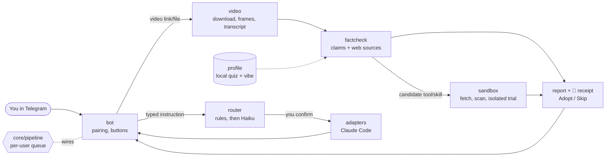

# Reelay

**Share any short video to your own Telegram bot. Your AI watches it, fact-checks it against who you are, and tries what's in it in a sandbox before you adopt anything.**

<!-- TODO(owner): replace with a real screen recording (≈15 s, Reel → verdict → trial report → Adopt). -->
> 🎞️ *Demo GIF placeholder — `docs/assets/demo.gif`*

Built for the November 2026 hackathon. Status: **8 core modules merged, 214 automated tests passing; the installer (T9) and a second AI adapter (T10) are not merged yet.** What has and hasn't been run live is listed honestly under [Limitations](#limitations).

## What it does

- 🎬 **Watches** a shared Reel / TikTok / YouTube Short / X video: downloads it, samples frames and gets the transcript (native subtitles, or Whisper if you opt in).
- 🔎 **Fact-checks** the claims it hears, with timestamps and *sources cited by the model* (web search only), worded for your profile (3-question quiz + a vibe dial).
- 🧪 **Trials** any tool or skill it finds: static scan first, then (with an API key) a measured run in an isolated folder. You get time, tokens and a verdict, and **Adopt / Skip** buttons. Adopt never installs anything for you.
- 🗣️ **Takes instructions** ("summarise the README, use opus"): a cheap Haiku router checks they're clear, you confirm, and your own Claude Code runs them inside an allow-listed project folder.

Every reply ends with a 🧾 **trust receipt**: what Reelay saw, checked, ran, and refused.

## Quickstart

```bash
curl -fsSL https://example.invalid/reelay/install.sh | sh   # PLACEHOLDER: install URL not final (installer T9 in progress)
reelay setup                                                # detects your AI tool, saves your Telegram bot token, shows a pairing code
# then, in Telegram, send your bot:  /start <code>
```

Today, from a checkout, the equivalent is `pip install -e '.[dev]'`, write `~/.reelay/config.toml` (see [DEMO.md](docs/DEMO.md#before-you-record)), and `python -m reelay` (add `--pair` for a new code).

## How it fits together



Modules only talk through the shared types in `reelay/core/types.py`. Video text never reaches the router or an adapter: those only see what **you typed**.

## Modules

| Module | Job | Notes |
|---|---|---|
| `core` | Shared types, TOML config, pipeline wiring, `python -m reelay` | `pipeline.py` = per-user queue, reports, receipts |
| `bot` | Telegram I/O, one-time pairing, Adopt/Skip | the only file importing python-telegram-bot is `telegram_layer.py` |
| `router` | Typed text → `Instruction` or one clarifying question | regex first; Haiku only if needed; output re-validated |
| `video` | yt-dlp download, ffmpeg frames, transcript | ≤ 200 MB, ≤ 10 min, no private hosts |
| `factcheck` | Claims, verdicts, sources, candidate tools | Claude Code (default) or API backend; strict JSON validation |
| `sandbox` | Fetch, scan, isolated trial, measured cost | live trial needs an API key; scan-only otherwise |
| `profile` | Quiz, vibe dial, local profile | `/profile`, `/vibe`, `/forget` |
| `adapters` | One file per AI tool, one interface | Claude Code today; adding a tool = one file + one list entry |
| `installer` | One-command setup | **in progress (T9), not merged** |

## Safety model, in plain words

- **Video is data, never instructions.** Captions, transcripts and on-screen text go into a delimited data block for fact-checking; nothing from a video can become a router message, adapter task or command.
- **Only you can talk to your bot.** One-time 15-minute pairing code; strangers get no reply and cause no download.
- **You tap before anything happens.** Reelay never installs. Adopt records your choice and prints a `git clone` line only for a plain `github.com/owner/repo` URL; you run it yourself.
- **Each AI call is locked down** to the fewest tools, in a throwaway folder, with a time limit and process-group kill.
- **Local-first.** Config, profile and decisions live in `~/.reelay/` (0700/0600). Claude (and Groq, if you enable Whisper) see only what a given step needs.

Full threat model, with the review finding behind each protection: [docs/SECURITY.md](docs/SECURITY.md).

## How it was built

An **Opus orchestrator** session planned the work, wrote the shared contract and the task board ([TASKS.md](docs/TASKS.md)), and merged only approved branches. **Parallel Sonnet builder agents** each owned one module in its own git worktree, and a different agent wrote a **written peer review** of each one ([`docs/reviews/`](docs/reviews/)). Rules: [AGENTS.md](AGENTS.md).

| Number | Value (from `git log` and the review files) |
|---|---|
| Commits on `main` | 44 over 2 days (28–29 Oct 2026) |
| Merge commits of approved branches | 11 |
| Reviews written | 8 module reviews + follow-up reviews (fallback, config, link-previews) |
| **BLOCKERs found by reviewers before merge** | **7**, across 4 modules (T3 bot ×2, T5 adapters ×1, T4 sandbox ×3, T8 pipeline ×1) |
| FIX items | 27 (hand count; see the review files) |
| Tests | 214 passing, no network/API key needed |
| Code | ≈ 2,950 lines in `reelay/`, ≈ 1,780 in `tests/` |

Examples of what review caught: the bot **downloaded files from strangers before checking pairing**; the sandbox's blanket `Read`/`Write` rules would have let a malicious skill read `~/.ssh`; two modules **read the same config file in incompatible formats**; the Adopt message could have printed a `git clone --upload-pack=…` line built from a video-supplied URL.

## Limitations

- **The sandbox is folder isolation, not a VM or container.** Same OS user, a fresh HOME, scoped tools and permission rules. A bug in Claude Code's permission system would not be contained. Docker is on the roadmap.
- **Live trials need an Anthropic API key.** Verified live: with the isolated HOME a Pro/OAuth login is not carried over (`Not logged in`). Without a key Reelay does a **scan-only** report and says so.
- **Not yet verified live** (reviewers had no key / a working login): the trial's `Read(//…)` permission rules and `--bare` hook-blocking (a canary-file test is still owed), the real `claude -p` JSON shape, the Haiku router against the live API, the API fact-check backend's search tool name, and Telegram end-to-end. All 214 tests use fakes. The owner's manual checklist is at the end of [T8.md](docs/reviews/T8.md).
- Fact-check results are *sources cited by the model*, not proof. DNS rebinding / redirects to private hosts aren't fully covered.
- Whisper (Groq) is opt-in and sends the audio to Groq. English subtitles only. Instagram carousels/images fail with a "send a screen recording" message.
- Queue and pending confirmations are in memory; a restart forgets them.

## Roadmap

1. Finish the one-command installer + QR pairing (T9).
2. Second adapter (Codex or Gemini; T10).
3. Docker/VM sandbox option; live canary and API-backed test suite.
4. Fit scoring against your real projects; profile learned from the videos you send.

Tests: `pip install -e '.[dev]' && pytest`. Spec: [docs/SPEC.md](docs/SPEC.md) · Architecture: [docs/ARCHITECTURE.md](docs/ARCHITECTURE.md) · Demo script: [docs/DEMO.md](docs/DEMO.md)
