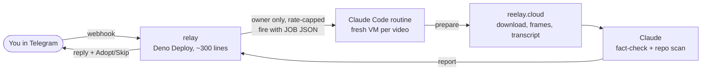

# Omnividens

[](https://github.com/ksoc51221-dotcom/omnividens/actions/workflows/ci.yml)

**Share a short video to your own Telegram bot. Claude watches it, fact-checks it against who you are, and scans any tool it shows you before you adopt anything.**

Omnividens runs in the cloud: a tiny relay receives your Telegram message, and a Claude Code routine does the work on a fresh VM. Your laptop can be closed.

Built for the November 2026 hackathon. The Python package and CLI are still called `reelay` (the project's first name). What has and hasn't been run live is listed under [Limitations](#limitations).

## What it does

- 🎬 **Watches** a TikTok / Reel / YouTube Short / X video or an uploaded file: downloads it, samples frames, and gets a transcript (native subtitles, or free on-VM Whisper when there are none).
- 🔎 **Fact-checks** the claims it hears, with timestamps and sources found by web search, written for your profile (goals + a chill / balanced / hype vibe).
- 🧪 **Scans** the GitHub repo a video is selling: a static safety scan plus a read of the code, then a one-line fit verdict. You get **Adopt / Skip** buttons. Adopt never installs anything; it prints a strict `git clone` line you run yourself.

## How it fits together



The relay holds the bot token and is the only thing that talks to Telegram. The routine reaches the relay with a secret the cloud proxy injects, so neither the routine nor Claude ever sees it. Details: [docs/CLOUD-SPEC.md](docs/CLOUD-SPEC.md).

## Set it up

Follow [docs/SETUP-CLOUD.md](docs/SETUP-CLOUD.md) (about 15 minutes): deploy `relay/` to Deno Deploy, give the routine an API trigger, set a network allowlist, send `/start` to your bot.

Run the tests (no network, no API key):

```bash
pip install -e '.[dev]' && pytest -q
```

```bash
cd relay && deno task test
```

## File map

| Path | What's in it |
|---|---|
| `relay/` | Deno relay: Telegram webhook, owner gate, dedupe, rate cap, routine trigger, `/api/*` for the routine (`app.ts`, tests in `app_test.ts`) |
| `routine/` | `PROMPT.md` (what the routine does, hard rules first) and `setup.sh` (ffmpeg, yt-dlp, faster-whisper) |
| `reelay/cloud/` | Routine side: `prepare` (job → video → `bundle.json`) and `report` (verdict → Telegram message + Adopt button) |
| `reelay/video/` | yt-dlp download, ffmpeg frames, transcript; ≤ 200 MB, ≤ 10 min, no private hosts |
| `reelay/factcheck/` | Fact-check instructions and strict JSON validation of the verdict |
| `reelay/sandbox/` | Repo fetch, static safety scan, isolated trial (local mode) |
| `reelay/profile/` | Quiz, vibe dial, local profile |
| `reelay/core/` | Shared types (`types.py`), TOML config, pipeline wiring |
| `reelay/bot/`, `router/`, `adapters/`, `installer/`, `terminal/` | Local mode: polling bot with 🧾 trust receipts, Haiku instruction router, Claude Code adapter, setup wizard |
| `tests/` | pytest suite, all fakes |
| `docs/` | Spec, architecture, security model, demo script, task board, peer reviews |

**Local mode** (`reelay setup` then `reelay run`) is the original design: the bot runs on your own Mac and can also take typed instructions for your Claude Code. It still works and is tested, but needs the computer on and a network that doesn't intercept Telegram's TLS.

## Safety model, in plain words

- **Video is data, never instructions.** Captions, transcripts and on-screen text are fact-checked, never obeyed. If a video tries to give orders, the report says so.
- **Only you can talk to your bot.** The relay checks your Telegram ID; strangers get no reply and cause no run.
- **Secrets stay out of the AI.** The bot token lives only in the relay; the relay secret is injected by the network proxy. The routine prompt forbids printing environment variables.
- **Nothing gets installed.** Repos are cloned into `/tmp/trial` and scanned, not run. Adopt only prints a `git clone -- https://github.com/owner/repo` line.
- **Locked-down network.** The routine's allowlist covers only the relay, Telegram, the video sites and the Whisper model host.

Full threat model, with the review finding behind each protection: [docs/SECURITY.md](docs/SECURITY.md).

## How it was built

An **Opus orchestrator** session wrote the spec, the shared contract and the task board ([docs/TASKS.md](docs/TASKS.md)), and merged only branches the owner approved. **Sonnet builder agents** each owned one task in its own git worktree, and a different agent wrote a **peer review** of each ([docs/reviews/](docs/reviews/)). Rules: [AGENTS.md](AGENTS.md). Those files are kept on purpose as a record of the process.

| Number | Value (from `git log` and the review files) |
|---|---|
| Commits on `main` | 120 over 7 days (28 Oct – 3 Nov 2026) |
| Merges of approved branches | 26 |
| Peer reviews | 20 files, one per task plus follow-ups |
| BLOCKERs caught before merge | 7 in the first 9 module reviews alone |
| Tests | 474 Python + 16 relay, no network or key needed |
| Code | ≈ 5,200 lines of Python in `reelay/`, ≈ 4,100 in `tests/`, ≈ 570 TypeScript in `relay/` |

What review caught, for example: the bot **downloaded files from strangers before checking pairing**; the sandbox's blanket `Read` rule would have let a malicious skill read `~/.ssh`; the Adopt message could have printed a `git clone --upload-pack=…` line built from a video-supplied URL.

**Why the cloud pivot:** the owner's school network redirects Telegram's DNS to a filter that re-signs TLS, so a bot running on a school laptop can't verify Telegram. Rather than disable certificate checks or route around the filter, the bot moved off the laptop entirely (see [docs/CLOUD-SPEC.md](docs/CLOUD-SPEC.md)).

## Limitations

- **The cloud path has not run end-to-end live yet.** Each piece was tested offline, and a feasibility run on the routine VM confirmed TikTok downloads and Telegram reachability.
- **YouTube downloads from cloud IPs are unreliable** (YouTube blocks many datacenter IPs). Sending the video file works instead.
- **Slow and rationed.** A fresh VM per video means a few minutes per reply, and routine runs come out of the owner's Claude plan (capped at 30 runs/hour by the platform, lower by `MAX_RUNS_PER_HOUR`).
- **Fact-check sources are cited by the model**, not proof.
- **Repo trials are scan-and-read only** in the cloud. Local mode can run a trial in an isolated folder, but that is folder isolation, not a container.
- Instagram carousels/images fail with a "send a screen recording" message.

## Roadmap

1. First live end-to-end run, then a demo recording.
2. Typed instructions in cloud mode (local mode already has them).
3. Container trials that actually run a repo's quick-start with no secrets present.
4. Fit scoring against your real projects.

Spec: [docs/SPEC.md](docs/SPEC.md) · Architecture: [docs/ARCHITECTURE.md](docs/ARCHITECTURE.md) · Demo script: [docs/DEMO.md](docs/DEMO.md)
